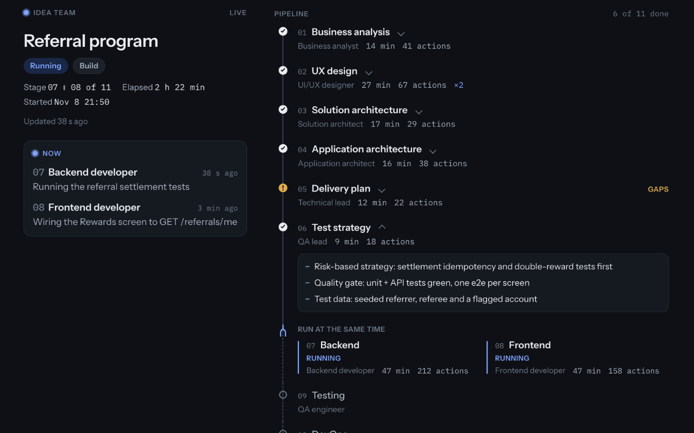
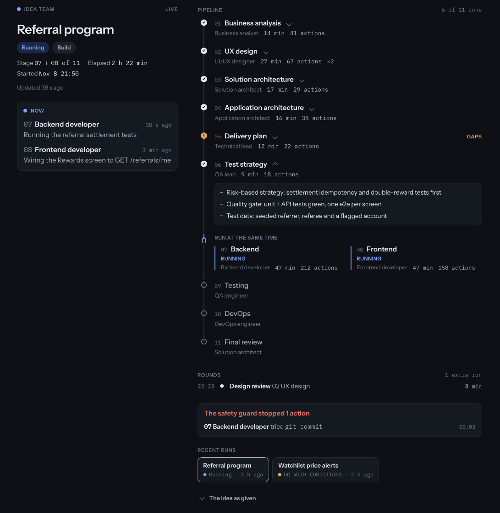
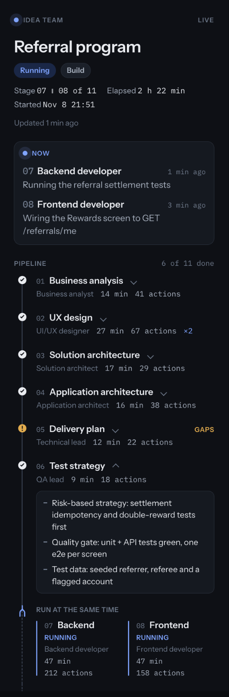

# Idea team for Claude Code and Codex

Ten senior agents that take an idea from a one-line description to a reviewed delivery plan. Each one improves on the work before it and hands off a document. Start with `/idea-team <your idea>` in Claude Code or `$idea-team <your idea>` in Codex.

| # | Stage | Agent | What it writes |
|---|-------|-------|----------------|
| 01 | Business analysis | senior-business-analyst | The real problem, users, scope, requirements, user stories with acceptance criteria, success metrics, a proceed / reshape / reconsider call |
| 02 | UX design | senior-ui-ux-designer | Flows, screens, every state and its wording, visual direction, and a clickable HTML prototype |
| 03 | Solution architecture | solution-architect | Options and trade-offs, the target architecture, technology decisions (ADRs), security, data, cost |
| 04 | Application architecture | application-architect | Domain model, data schema, module boundaries, API and event contracts |
| 05 | Delivery plan | senior-technical-lead | Tasks with estimates and dependencies, milestones, a "build now" slice, file ownership |
| 06 | Test strategy | senior-qa-lead | Risk-based test strategy, quality gates, entry and exit criteria |
| 07 | Backend | senior-backend-developer | A build-ready backend design (plan mode) or the code (build mode) |
| 08 | Frontend | senior-frontend-developer | A build-ready frontend design (plan mode) or the code (build mode) |
| 09 | Testing | senior-qa-engineer | Test cases and a coverage matrix, or test runs and defect reports |
| 10 | DevOps | senior-devops-engineer | CI/CD, environments, observability, rollback, runbooks |
| 11 | Final review | solution-architect | GO, GO WITH CONDITIONS or NO-GO |

Later stages can send work back to earlier ones when they find a problem, so a requirement that can't be built gets fixed where it was written.

To keep token use down, each document has a word budget, long detail (every test case, full API schemas, every string of copy) goes in appendix files that later stages consult item by item, agents read the summaries and only the sections they need, and documents are written in parts.

## What you need

For Codex, see [Codex installation and use](#codex-installation-and-use) below. The following requirements and the original installation instructions apply to Claude Code.

- [Claude Code](https://claude.com/claude-code), the desktop app or the CLI, on macOS or Linux.
- Python 3 (`python3`).
- A plan with plenty of usage. A full run is eleven or more stages, most of them on Opus at high effort, and takes a few hours. On a smaller plan, expect it to pause when a usage limit is reached; you can resume it later.
- Fable access is used for the designer. Without it, the run uses Opus for that stage instead.

## Install

```bash
git clone https://github.com/anwar-elmawardy/idea-team.git
cd idea-team
bash install.sh
```

This copies the skill, the agent sources and the safety guard into `~/.claude`, builds the ten agents into `~/.claude/agents/`, and runs the guard's self-test. Then **start a new Claude Code session**: a session that is already open doesn't see new agents.

To update later: `git pull && bash install.sh`, then start a new session.

To remove it: `bash uninstall.sh`.

## Codex installation and use

Codex needs Python 3 and a host with native subagent tools. It does not need Claude
Code, an API key, or a separate AI runner. From this repository:

```bash
bash install.sh --codex
```

This installs a self-contained skill to `${CODEX_HOME:-~/.codex}/skills/idea-team/`.
It adapts the same ten role sources into references, preserving their output templates
and handoffs, and uses the Codex orchestrator in `codex/SKILL.md`. It leaves Claude's
agents, hooks, memory and configuration alone. Updates preserve the previous Codex
installation under `CODEX_HOME/backups/`; an existing unrecognized skill or symlink
is refused. If your current chat does not discover the skill, open a new Codex chat.

In the target project's Codex chat:

```text
$idea-team add a weekly leaderboard with friends-only rankings
$idea-team docs/ideas/<date>-<slug> --from 07
```

Plan mode writes the same design pack and prototype in `docs/ideas/`. Only an explicit
`--build` requests implementation, and the project's own rules may prohibit it (for
example, Frenzy Bash uses the team for planning and the coordinating session for
implementation). The Codex adapter leaves changes reviewable without committing or
pushing them. Native subagents inherit the current model unless the user or repository
explicitly specifies model routing; it does not assume Claude's model names exist.

Codex pauses at **30% or less usage remaining**, or a stricter owner reserve, and
requires an explicit instruction to resume. It checks the host's usage tool before
stages and every five minutes during sustained work. If that tool is unavailable it
reports that enforcement cannot be verified. A full design run still consumes substantial
usage and can take hours; installing the skill does not start one.

**Guard limitation:** the Claude PreToolUse guard is not active in Codex. This adapter
uses workflow instructions and the host's actual permissions; it does not claim hook
enforcement or a security sandbox. Do not assume the two runtimes have identical safety
controls. See [OpenAI's skill conversion guidance](https://developers.openai.com/plugins/guides/submit-claude-plugin).

To update, pull the desired changes and rerun `bash install.sh --codex`. To remove only
the Codex skill, run `bash uninstall.sh --codex`; saved idea packs and backups remain.
The original no-flag install/uninstall commands continue to target Claude only.

Validate the adapter without launching agents or spending model usage:

```bash
python3 -m unittest discover -s codex -p 'test_*.py' -v
python3 codex/build.py build --output /tmp/idea-team-codex-preview
```

The build output directory must not already exist. Edit `codex/SKILL.md` for the
Codex workflow, `codex/build.py` for runtime conversion, and `skills/idea-team/agents-src/`
for the shared specialist templates. Reinstall to apply changes.

## Use

Open Claude Code in the project the idea is about, then:

```
/idea-team add a weekly leaderboard with friends-only rankings
```

- **Plan mode** (the default) produces a full design pack in `docs/ideas/<date>-<slug>/`, including the clickable prototype, and writes no product code.
- **Build mode**, `/idea-team --build <idea>`, also implements the delivery plan's "build now" slice in a separate git worktree on a branch `idea/<slug>`, tests it, and commits there if the final review isn't NO-GO. It never pushes.
- **Resume** a paused or stopped run: `/idea-team docs/ideas/<date>-<slug> --from NN`.

At the end you get a `README.md` in the idea folder with the verdict, the improved idea, key decisions, risks and the questions only you can answer.

## Screenshots

These show sample data, not a real project. They come from **idea-team-live**, a separate add-on that is **not in this repository yet**: a live status page (and, in the Claude desktop app, a panel beside the chat) that shows every stage, what each agent is doing right now, send-back rounds, and anything the safety guard blocked.







## Safety

Every agent runs a guard (`hooks/idea-team-guard.py`) before each command and file access. It blocks git changes, pushes and deploys, remote hosts and cloud CLIs, destructive database and container commands, other AI CLIs, reading `.env` and credential files, and writing to `~/.claude` (except the agents' own memory). The browser is limited to localhost. It's a blocklist, so it can't catch everything; the agents' instructions are the first line of defence.

## Changing the agents

Don't edit `~/.claude/agents/` directly; the next build overwrites it. Edit the sources in `skills/idea-team/agents-src/`:

- `<agent>.md`: one agent's role, steps and output template.
- `_shared.md`: the team table and the rules every agent follows.
- `_sentback.md`: what an agent does when its work is sent back.

Then run `bash install.sh` again and start a new session. The orchestrator, which runs the stages and picks each stage's model, is `skills/idea-team/SKILL.md`.

Each agent keeps its own memory in `~/.claude/agent-memory/<agent>/`, so it learns across runs.

## License

MIT. See [LICENSE](LICENSE).
